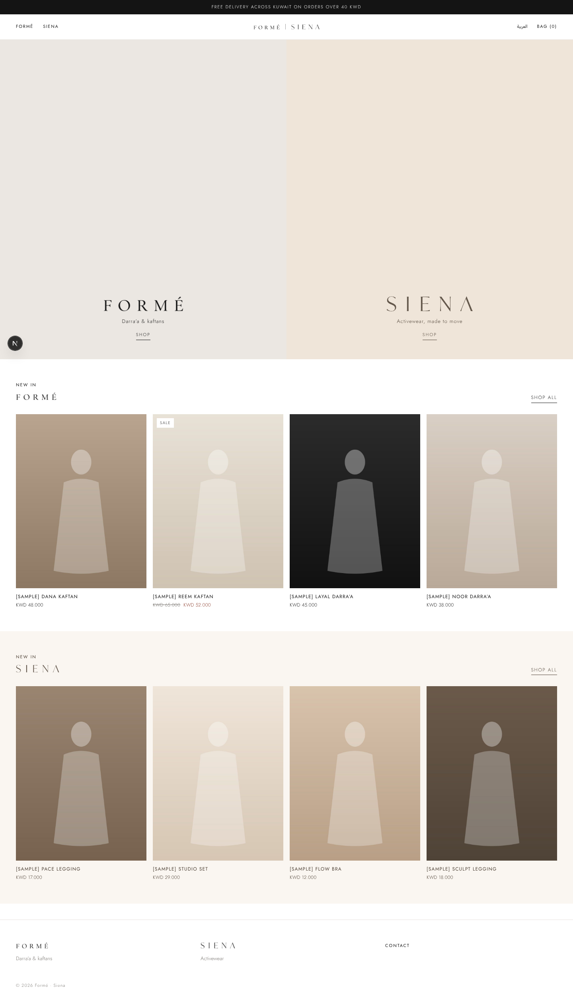
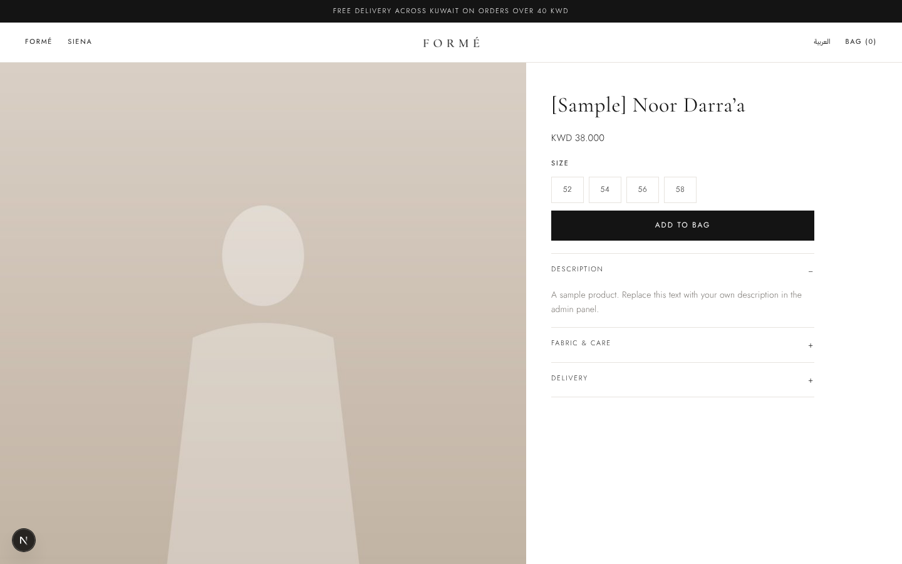
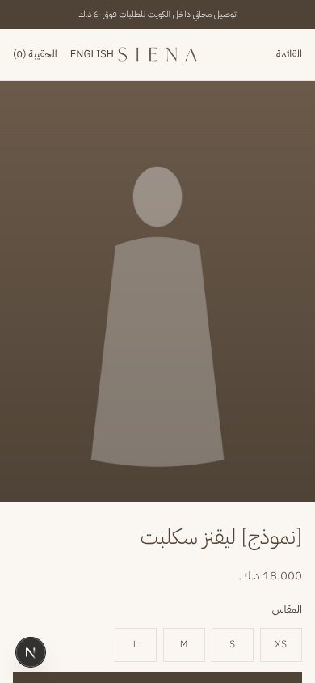
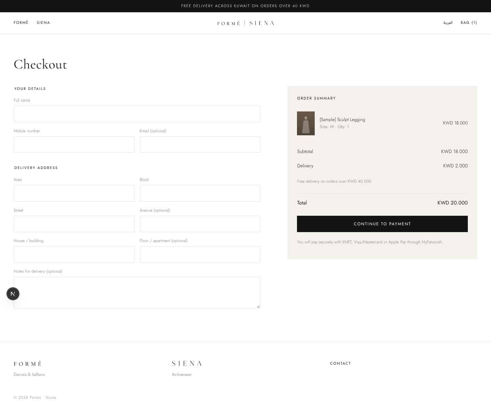
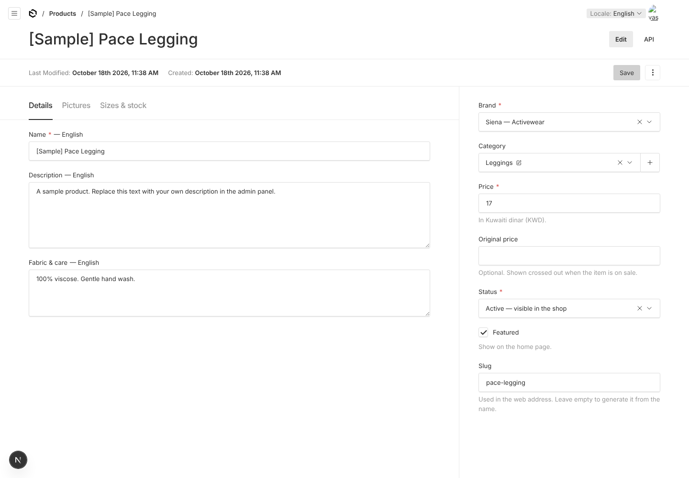

# Formé · Siena

One online store for two brands:

- **Formé** — darra’a (دراعات) and kaftans
- **Siena** — activewear

Each brand has its own section, colours and logo, and they share one bag and one checkout. The shop is in English
and Arabic (right-to-left), payments go through **MyFatoorah** (KNET, Visa/Mastercard, Apple Pay), and the seller
manages everything from an admin panel at `/admin`.

| Home | Product | Arabic, mobile |
| --- | --- | --- |
|  |  |  |

| Checkout | Admin: editing a product |
| --- | --- |
|  |  |

## Built with

- [Next.js](https://nextjs.org) (the website)
- [Payload CMS](https://payloadcms.com) (the admin panel, running inside the same app)
- SQLite / [Turso](https://turso.tech) (the database)
- MyFatoorah v2 API (payments)

## Run it on your computer

Requires Node.js 20.18 or newer.

```bash
npm install
cp .env.example .env      # then fill in PAYLOAD_SECRET (any long random text)
npm run seed              # optional: creates an admin account and sample products
npm run dev
```

- Shop: http://localhost:3000
- Admin panel: http://localhost:3000/admin (seed login: `admin@example.com` / `change-me-now`; change it)

## For the seller: using the admin panel

Sign in at `/admin`. Use the **Locale** switch at the top right to enter text in English and in Arabic. Arabic is
optional; if it is left empty, the English text is shown.

**Add a product:** Products → Create new.

1. **Details**: name, description, and fabric & care.
2. **Pictures**: upload one or more. The first is the main picture; the second appears when shoppers hover.
3. **Sizes & stock**: add each size (for example `52`, `54` or `S`, `M`, or `One size`) with the number of pieces.
   A size with 0 pieces shows as sold out. Stock goes down automatically when an order is paid.
4. On the right: choose the **brand** (Formé or Siena), a **category**, the **price** in KWD, and an
   optional **original price** to show a sale. Set **Status** to *Hidden* to take a product off the shop without
   deleting it, and tick **Featured** to show it on the home page.

**Categories**: the filters on each brand page (for example *Darra’a*, *Kaftans*, *Leggings*, *Sets*).

**Orders**: every paid order, with the customer’s phone and delivery address. Change the status to *Shipped* and
*Delivered* as you go. Orders that say *Awaiting payment* were not paid.

**Store settings**: the announcement bar, the two cover pictures and taglines on the home page, the delivery fee,
free delivery threshold, WhatsApp number, email and Instagram links.

**Users**: add staff accounts.

## MyFatoorah payments

1. In the MyFatoorah portal, go to **Integration Settings → API Key** and copy the key into `MYFATOORAH_API_KEY`.
2. Start with the test environment (`MYFATOORAH_BASE_URL=https://apitest.myfatoorah.com` with a test API key).
   When you are ready to take real payments, switch to the live key and the live URL for your country:
   Kuwait `https://api.myfatoorah.com`, Saudi Arabia `https://api-sa.myfatoorah.com`, Qatar
   `https://api-qa.myfatoorah.com`, UAE `https://api-ae.myfatoorah.com`.
3. Recommended: in **Integration Settings → Webhook**, enable the webhook and set the URL to
   `https://YOUR-DOMAIN/payment/webhook`. This confirms orders even if a customer closes the browser before
   returning to the shop.

How it works: at checkout the server re-prices the bag from the database and checks stock, creates an order marked
*Awaiting payment*, and sends the customer to MyFatoorah’s payment page. When MyFatoorah sends them back
(`/payment/callback`) or calls the webhook, the shop asks MyFatoorah for the real payment status. Only then is the
order marked *Paid* and stock reduced (once, however many times it is confirmed).

The code is in `src/lib/myfatoorah.ts` and `src/lib/orders.ts`.

## Putting it online

The simplest setup is [Vercel](https://vercel.com) with a [Turso](https://turso.tech) database and Vercel Blob for
pictures:

1. Create a Turso database. Set `DATABASE_URL` (`libsql://…`) and `DATABASE_AUTH_TOKEN`.
2. In the Vercel project, add a **Blob** store; this sets `BLOB_READ_WRITE_TOKEN`, and pictures uploaded in the admin
   are then stored there.
3. Set `PAYLOAD_SECRET`, `NEXT_PUBLIC_SERVER_URL` (your domain) and the MyFatoorah variables.
4. Deploy. The database tables are created automatically on first start (from `src/migrations`).

Use a fresh database for production, not the development `forme.db`. To get sample data or the first admin
account, run `npm run seed` once with the production environment variables. You can also create the first admin
in the browser at `/admin`.

Any Node.js host works too (Railway, Render, a VPS). Without `BLOB_READ_WRITE_TOKEN`, pictures are saved in the
`media/` folder, so that folder must be on persistent storage.

## For developers

- `src/collections`, `src/globals`: the CMS data model (products, categories, orders, media, users, settings)
- `src/app/(frontend)/[lang]`: the shop pages (`/en`, `/ar`, `/en/forme`, `/en/siena/<product>`, checkout, order)
- `src/app/payment`: MyFatoorah callback and webhook
- `src/lib/i18n.ts`: English and Arabic interface text
- `src/app/(frontend)/styles.css`: all shop styling. Siena’s warm palette is applied automatically on its pages.
- `public/brand`: the two logos, used as masks so they take the page colour

After changing a collection’s fields, run `npm run generate:types`, then
`npm run payload migrate:create <name>` so production databases get the change.

Checks: `npm run typecheck`, `npm run lint`, `npm run build`.
